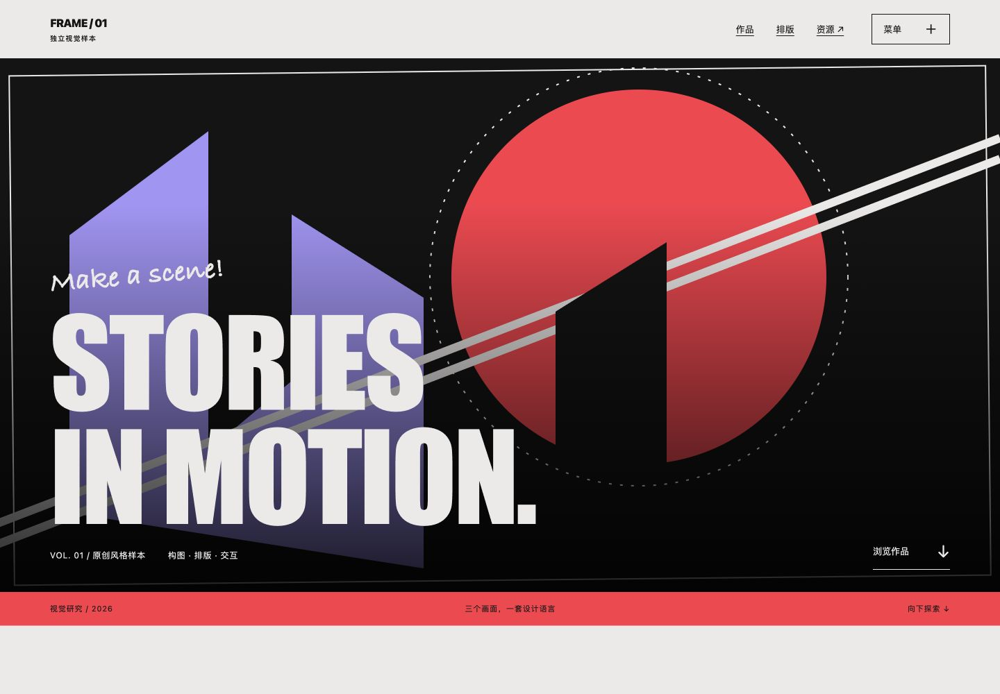
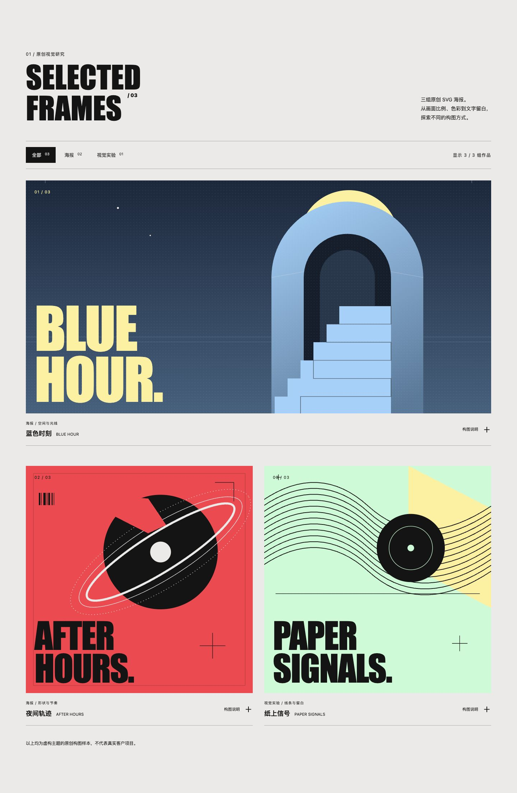
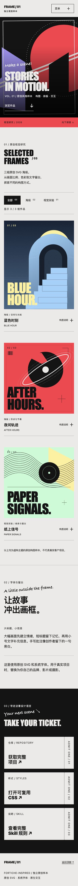

# Fortiche Style

**让页面像一张正在放映的电影海报。**

一个受 [Fortiche 官网](https://forticheprod.com/) 启发的 Codex 前端设计 skill。将大幅影像、超大窄体标题、手写旁白和票券式交互，整理成可用于自己项目的设计规则与代码起点。

[设计语言](#它能帮你做什么) · [安装](#安装) · [使用](#使用) · [预览](#预览) · [设计参考](fortiche-style/references/design-system.md)

## 先看一眼



*原创样例：海报首屏、三组视觉研究、中文排版与票券入口。作品支持分类筛选和构图说明展开。*

本项目是独立的学习与设计研究，与 Fortiche 无隶属或合作关系。上图为本仓库的原创样例；设计来源与核查边界见文末说明。

## 它能帮你做什么

| 设计语言 | 落到页面上 |
| --- | --- |
| 电影感 | 主视觉占据大面积，内容围绕画面焦点组织 |
| 海报排版 | 巨型窄体标题与小号 credits 形成鲜明层级 |
| 创作者旁白 | 少量手写批注、斜线和箭头呼应内容 |
| 印刷物细节 | 纸灰、炭黑、珊瑚红，搭配硬边与票根 |
| 有节制的动态 | 画框反馈、局部位移、入场节奏及静态回退 |

适合创意工作室、个人作品集、影视与品牌展示页。支持中文排版、手机布局和局部组件改造；尊重项目原有技术栈，不要求 WordPress 或特定动画库。

### 同一种风格，也可以有不同分寸

| 表达强度 | 适合什么情况 | 会保留哪些特征 |
| --- | --- | --- |
| 轻量 | 已有产品、局部改造、内容较多 | 色彩、标题对比，以及一处票券或手写注释 |
| 标准 | 个人作品集、品牌首页 | 强主视觉、明暗章节、少量手写细节与交互反馈 |
| 鲜明 | 创意工作室、影视或活动专题 | 更大的标题比例、更明显的画框和局部动态 |

三种强度都以内容可读、手机可用为前提。你可以让它只改一个作品展示区，也可以让它组织整张首页。

## 安装

将本仓库中的 **`fortiche-style/` 子目录**放入个人 skills 目录。安装后的结构应为 `skills/fortiche-style/SKILL.md`，而不是再多嵌套一层仓库目录。

macOS / Linux 可使用以下命令。已有同名 skill 时会停止，避免覆盖你的修改：

```bash
git clone https://github.com/carefreelove/fortiche-style-skill.git
cd fortiche-style-skill
python3 - <<'PY'
from pathlib import Path
import os
import shutil

codex_dir = Path(os.environ.get("CODEX_HOME") or Path.home() / ".codex").expanduser()
destination = codex_dir / "skills" / "fortiche-style"
if destination.exists():
    raise SystemExit(f"已存在，未覆盖：{destination}")
destination.parent.mkdir(parents=True, exist_ok=True)
shutil.copytree("fortiche-style", destination)
print(f"已安装：{destination}")
PY
```

本仓库公开可读。Windows 用户可下载仓库 ZIP，解压后将 `fortiche-style/` 子目录复制到 `%USERPROFILE%\.codex\skills\`；如已设置 `CODEX_HOME`，则使用该目录下的 `skills/`。

更新时，在克隆的仓库中执行 `git pull --ff-only`，再将新版本复制到安装目录。若你修改过已安装的 skill，请先备份并比较差异；上面的安装命令不会自动覆盖它。

## 使用

在支持 Codex skills 的会话中明确调用，并说明页面用途、技术栈和真实内容：

```text
使用 $fortiche-style，为我制作一个中文个人作品集。
保留现有 React 技术栈，突出三个代表项目。
使用标准强度：大幅作品图、清晰的中文标题和少量手写注释。
联系入口使用票券样式，动效适度，优先保证手机可读。
```

也可以缩小范围或降低视觉强度：

```text
使用 $fortiche-style，只改造当前首页的作品展示区和联系入口。
保持其余页面结构，使用轻量表达，优先照顾手机浏览。
```

### 让结果更贴合你的项目

- **给出内容**：真实项目名称、简短介绍、图片或视频，比统一的占位文本更能帮助建立构图。
- **说明范围**：整站、单页或一个组件，都可以单独应用这套风格。
- **说明约束**：例如保留现有组件、优先中文阅读，或只使用静态图片。

没有视频也可以从静态海报或摄影开始。skill 提供设计判断与工作流程，最终效果取决于内容、素材、字体和具体实现；样例中的抽象 SVG 只是一个构图起点。

## 预览

下载仓库后，在浏览器中打开 `fortiche-style/assets/specimen.html`。GitHub 上的 [文件链接](fortiche-style/assets/specimen.html) 用于查看源码；运行预览也可以在仓库根目录启动本地服务：

```bash
python3 -m http.server 8765 --bind 127.0.0.1
```

浏览器访问 `http://127.0.0.1:8765/fortiche-style/assets/specimen.html`。样例无需构建或第三方运行时库，使用系统字体、本地原创 SVG 和少量原生 JavaScript；字体效果随系统可用字体略有变化。

| 可以体验的内容 | 交互方式 |
| --- | --- |
| 三组原创海报 | 宽幅主作品与双列展示，手机自动改为单列 |
| 作品筛选 | 切换全部、海报、视觉实验，实时显示结果数量 |
| 构图说明 | 点击作品标题行或使用键盘展开，查看配色与构图思路 |
| 全屏菜单 | 章节导航、Escape 关闭、焦点恢复 |
| 资源票券 | 访问 GitHub 仓库、CSS 和 skill 文件 |

脚本未加载时，全部作品、常规导航和原生折叠说明仍可使用。样例包含 hover/focus 反馈及减少动态效果样式，没有影片播放或持续滚动动画。



<details>
<summary>查看手机布局</summary>



</details>

## 仓库内容

如果想先理解这套风格，可以按下面的顺序阅读：

| 文件 | 内容 |
| --- | --- |
| [SKILL.md](fortiche-style/SKILL.md) | skill 的适用范围、设计流程和验收重点 |
| [design-system.md](fortiche-style/references/design-system.md) | 配色、字体、构图与动效的具体取舍 |
| [fortiche.css](fortiche-style/assets/fortiche.css) | 可独立参考的样式基础，统一使用 `.ft` 作用域 |
| [components.md](fortiche-style/references/components.md) | 组件拆分、作品替换、交互与无脚本降级 |
| [source-notes.md](fortiche-style/references/source-notes.md) | 官网来源，以及确认事实与适配建议的区别 |

```text
fortiche-style/
├── SKILL.md                    # 触发范围、设计流程与验收重点
├── agents/openai.yaml          # 显示名称和调用提示
├── references/
│   ├── design-system.md        # 配色、字体、构图、动效与降级
│   ├── components.md           # 组件移植与交互约定
│   └── source-notes.md         # 一手来源、核查日期与证据边界
└── assets/
    ├── artwork/                # 三组原创 SVG 海报
    ├── fortiche.css            # 带 .ft 作用域的原创基础样式
    ├── specimen.js             # 菜单与分类筛选的渐进增强
    └── specimen.html           # 可直接打开的作品集样例
```

## 来源与验证

官网 HTML/CSS 的核查日期为 **2026-10-19**。颜色、字体角色和组件特征来自公开资源；中文适配、动效建议与样例代码是本项目的设计转译。完整记录见 [source-notes.md](fortiche-style/references/source-notes.md)。

当前验证情况：

- skill 已通过格式校验，文档中的本地文件链接已检查。
- 原创样例已在 1440px、768px、390px 和 320px 宽度下检查，无横向溢出；键盘跳转可聚焦主要内容。
- 作品筛选与计数、键盘展开说明、菜单内 Tab 循环、Escape 关闭及焦点恢复已在浏览器中检查；移除增强脚本后，常规导航、全部作品与原生折叠说明仍可使用。
- 官网媒体加载受限，尚未完整实测其滚动和播放效果；源码中的动效配置与本地样例的实际效果分别记录。

本仓库不包含 Fortiche 的影片、标识或商业字体。用于自己的项目时，请替换为自己的品牌和可用素材；字体替代也会影响最终的排版气质。

## 交流与改进

如果你也喜欢这种风格，欢迎通过 [Issues](https://github.com/carefreelove/fortiche-style-skill/issues) 分享使用效果、排版问题或改进建议。反馈时附上页面截图、屏幕宽度和希望调整的地方，会更容易讨论具体设计。
